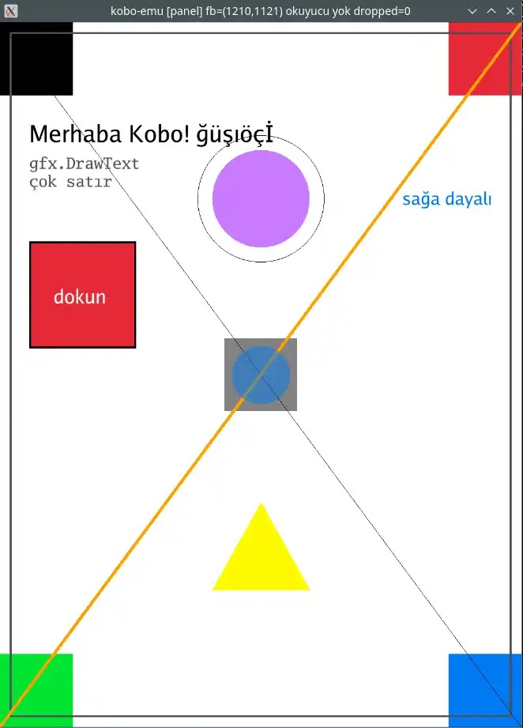

# ereader-screen-simulator



A screen and touch emulator for Kobo e-readers, written in Go. It lets you develop on your computer instead of connecting to the device over SSH for every test. It also ships a small drawing/touch library (`gfx`) so the same application code runs both in the emulator and on the device.

The current target is the **Kobo Clara Colour** (MediaTek `hwtcon`, 32-bit ARM, Kaleido 3). Device details live in a profile file: [profiles/clara-colour.json](profiles/clara-colour.json).

> **Status:** the screen, the e-ink refresh model and mouse-driven touch work. Replaying recorded touch input, screenshots and a status bar are not implemented yet.

## How it works

The emulator creates a few files that stand in for the device's hardware interfaces. Your application uses them instead of the real `/dev/fb0` and `/dev/input/event1`.

```
┌──────────── Computer ────────────────────────────────────────────────┐
│                                                                      │
│  Your app (gfx)                       Emulator (this project)        │
│   ├─ mmap ───────────►  fb0  ◄──────── reads the refreshed region    │
│   ├─ "refresh" ──────►  eink.sock ──► panel model ──► window         │
│   └─ reads ◄─────────  event1 (FIFO) ◄── mouse → Kobo event bytes    │
│                                                                      │
└──────────────────────────────────────────────────────────────────────┘
```

| File (`/tmp/kobo-emu/`) | Purpose |
|---|---|
| `fb0` | Framebuffer, same layout as on the device (1072x1448, 32 bpp, RGBA). Both sides `mmap` it. |
| `fb0.json` | Framebuffer info (the values the real device returns from its ioctls) |
| `devices.json` | The touch device and its axis ranges |
| `eink.sock` | Refresh requests (`update` / `wait`, one JSON message per line) |
| `event1` | Touch events. A FIFO carrying Kobo's 16-byte `input_event` records. |

It behaves like e-ink: writing to `fb0` does not change the screen. The window only updates a region when a refresh request for it arrives, so "I wrote to memory but forgot to refresh" bugs show up in the emulator too.

**Scope:** screen and touch only. CPU, Wi-Fi, sleep, the power button, Nickel, etc. are not emulated.

## Requirements

- Go 1.26 or newer (Go downloads it automatically if yours is older)
- Linux with X11 and OpenGL development packages. The window uses [Ebitengine](https://ebitengine.org/en/documents/install.html), which needs cgo; follow its package list for your distro.
- To build for the device: nothing extra. Go cross-compiles to ARM without cgo.

## Quick start

Start the emulator:

```sh
make start
# or: go run . -dir /tmp/kobo-emu
```

A white window opens. In another terminal, run an example app:

```sh
go run ./examples/fbsquare
```

Colored squares, lines and text appear in the window. Click the square labeled "dokun" ("touch") to change its color. Click the black square in the top-left corner to quit.

### Emulator flags

| Flag | Default | Description |
|---|---|---|
| `-dir` | `/tmp/kobo-emu` | Directory for the contract files |
| `-profile` | `profiles/clara-colour.json` | Device profile |
| `-scale` | `0` (fit to screen) | Window scale; 1072x1448 does not fit most monitors |
| `-eink` | `ideal` | `ideal`, `approx` or `raw` (see below) |
| `-record` | | Write the generated touch events to a file |

The profile path is relative to the working directory, so run the emulator from the `emu/` directory.

### Window controls

| Input | Action |
|---|---|
| Left click / drag | Finger (touch and drag) |
| `Ctrl` + drag | Second finger (mirrored around the screen center) |
| `F1` | Show the touch trail |
| `F2` | Outline recently refreshed rectangles (partial: red, full: blue) |
| `F3` | Toggle between the panel view and the raw framebuffer view |

The window title shows the current view, the mouse position, whether a touch reader is attached, and the number of dropped event groups.

### E-ink modes (`-eink`)

- **`ideal`**: the requested region is copied as is, with no delay. Only the "invisible until refreshed" rule applies.
- **`approx`**: approximate e-ink behavior. `DU` and `A2` threshold to black/white, `GC16`/`GL16` reduce to 16 gray levels, `GLR16`/`GLD16` keep color, and a full refresh (`full`) flashes black then white. Update durations come from the profile (rough values).
- **`raw`**: starts in the raw framebuffer view.

`approx` does not model the real panel's ghosting, color filter or exact timing. Its purpose is to expose logic mistakes early, such as "I pushed color content with a grayscale waveform". Make visual-quality decisions on the device.

## The gfx library

[gfx/](gfx/) is a separate Go module (`module kobogfx`) with no dependency on the emulator code. It draws straight into the framebuffer and listens for touch with a raylib-like API. **The same code runs on the Kobo and in the emulator**; the only difference is the path passed to `Init` and `InitTouch`.

To use it in your own project:

```
require kobogfx v0.0.0
replace kobogfx => /path/to/emu/gfx
```

### Example

```go
import gfx "kobogfx"

func main() {
    gfx.Init("/dev/fb0")             // in the emulator: "/tmp/kobo-emu/fb0"
    defer gfx.Close()                // also releases the touch grab

    gfx.ClearBackground(gfx.WHITE)
    gfx.DrawRectangle(60, 450, 220, 220, gfx.RED)
    gfx.DrawText("Hello Kobo!", 60, 200, 48, gfx.BLACK)
    gfx.EndDrawing()                 // refresh the panel

    gfx.InitTouch("")                // "" = find the device automatically
    btn := gfx.Rect{X: 60, Y: 450, W: 220, H: 220}
    for {
        gfx.WaitTouch(0)             // sleeps until an event arrives, then updates the state
        if gfx.IsTouchPressed(btn) {
            gfx.DrawRectangle(btn.X, btn.Y, btn.W, btn.H, gfx.BLUE)
            gfx.RefreshRectEx(btn.X, btn.Y, btn.W, btn.H, gfx.GC16, false)
        }
    }
}
```

### API overview

**Screen and refresh**

| Function | Description |
|---|---|
| `Init(fbPath)` | Opens `/dev/fb0` (device) or `.../fb0` (emulator); it detects which one it is |
| `Close()` | Closes everything |
| `GetScreenWidth()`, `GetScreenHeight()` | Screen size |
| `EndDrawing()` | Refreshes the whole screen |
| `RefreshRect(x, y, w, h)` | Refreshes a region with the default mode |
| `RefreshRectEx(x, y, w, h, wf, full)` | Refreshes a region with a chosen waveform and full/partial mode |
| `SetRefreshMode(wf, full)` | Changes the default waveform (initially `GC16`, full) |

Waveforms: `INIT`, `DU` (fast black/white), `GC16` (best grays), `GL16`, `GLR16`, `A2` (fastest).

**Drawing**

`ClearBackground`, `DrawPixel`, `GetPixel`, `DrawLine`, `DrawLineEx` (thick), `DrawRectangle`, `DrawRectangleLines` (thick), `DrawCircle`, `DrawCircleLines`, `DrawTriangle`. Coordinates outside the screen are silently clipped.

**Colors**

`BLACK`, `WHITE`, `RED`, `GREEN`, `BLUE`, `YELLOW`, `ORANGE`, `PURPLE`, `PINK`, `GRAY`, `LIGHTGRAY`, `DARKGRAY` and the other raylib colors. Helpers: `RGB`, `RGBA`, `Fade` (alpha blending).

**Text**

`DrawText(text, x, y, size, color)`, `DrawTextEx(font, ...)`, `MeasureText`, `MeasureTextEx`. Fonts are `FontRegular`, `FontBold` and `FontMono`, embedded in the binary, so no font files are needed on the device. Latin characters including Turkish letters (ğ ü ş ı ö ç İ) are supported. `\n` starts a new line.

**Touch**

| Function | Description |
|---|---|
| `InitTouch(path)` | Starts listening for touch (after `Init`). `""` finds the device automatically |
| `WaitTouch(timeout)` | Waits for an event (0 = forever), then updates the state |
| `UpdateTouch()` | Updates the state manually (only for polling loops that do not use `WaitTouch`) |
| `IsTouchPressed(rect)` | A finger went down inside `rect` since the last update |
| `IsTouchDown(rect)` | A finger is currently down inside `rect` |
| `IsTouchReleased(rect)` | A finger lifted inside `rect` since the last update |
| `GetTouchPointCount()`, `GetTouchPosition(i)` | Number of fingers down and their screen positions |
| `SetTouchTransform(swap, mirrorX, mirrorY)` | Changes the raw-to-screen coordinate mapping (Clara Colour default: swap + mirrorX) |
| `CloseTouch()` | Stops listening |

**Touch grab:** on a Kobo, `InitTouch` takes exclusive access to the touch device with `EVIOCGRAB`. While your program runs, Nickel and other processes receive no touches; they come back after `CloseTouch`, `Close`, or when the process exits. Quick taps are not lost: a finger that goes down and up between two updates is reported as both `Pressed` and `Released`.

## Running on the device

The examples are built for the Kobo (32-bit ARM) with `make` and served over a small HTTP server:

```sh
make example fbsquare      # builds bin/fbsquare and serves it on :8000
```

To build by hand:

```sh
CGO_ENABLED=0 GOOS=linux GOARCH=arm GOARM=7 go build -o bin/fbsquare ./examples/fbsquare
scp bin/fbsquare root@<kobo-ip>:/mnt/onboard/
```

On the device:

```sh
./fbsquare -fb /dev/fb0
```

Tips:

- While Nickel is running it may redraw the screen and erase what you drew. Stop Nickel if you need to.
- While the touch grab is active Nickel does not react to touches. It reacts again once your program exits.
- An e-ink screen does not change without a refresh; call `EndDrawing` or `RefreshRect` after drawing.

## Examples

| Example | What it does |
|---|---|
| [examples/fbsquare](examples/fbsquare) | Shapes, text and a square that changes color when touched |
| [examples/touchdraw](examples/touchdraw) | Draws a line wherever you touch. Top-left corner clears, top-right corner quits. |

Both accept `-fb` (default `/tmp/kobo-emu/fb0`) and `-touch` (default: automatic).

## Project layout

```
.
├── main.go            # flags, directory setup, starting the components
├── profiles/          # device profile: fb, axes, transform, event template, timings
├── profile/           # profile loading and validation
├── fbfile/            # fb0 creation, mmap, fb0.json
├── panel/             # e-ink panel model (ideal / approx)
├── einksock/          # eink.sock: update / wait protocol
├── touch/             # mouse → Kobo events (FIFO, Protocol A, coordinate transform)
├── ui/                # Ebitengine window, keyboard and mouse
├── gfx/               # standalone drawing and touch library (separate module)
└── examples/          # fbsquare, touchdraw
```

Tests: `go test ./...` (emulator) and `cd gfx && go test ./...` (library).

## Contract details

**Touch events** imitate the Protocol A sequence produced by the real `cyttsp5_mt` device. The first group of a gesture carries `BTN_TOOL_FINGER 1`, `BTN_TOUCH 1` and a contact block. Dragging sends contact blocks only. The release group carries `ABS_X`, `ABS_Y` and `ABS_PRESSURE 0` for each finger, followed by the key events. While moving, a group is produced at most every 13 ms; while holding still, one repeats every 40 ms. `input_event` is **16 bytes** on every platform (32-bit `timeval`); the 24-byte layout of a 64-bit computer is never used. The sequence is not hard-coded; it is generated from a template in the profile.

**The refresh socket** takes one JSON message per line:

```json
{"op": "update", "marker": 12, "rect": [x, y, w, h], "waveform": "GC16", "full": true}
{"op": "wait", "marker": 12}
```

Responses are `queued`, `done` and `error`. `wait` does not answer until the given `marker` has finished, like the real `WAIT_FOR_UPDATE_COMPLETE`.

The full contract is defined in [PLAN.md](PLAN.md).

## Limitations

- The emulator does not exercise the real driver (the `hwtcon` ioctls), so device-specific bugs only show up on the device.
- A FIFO has a single reader and `EVIOCGRAB` has no effect on it. Forwarding touches to Nickel (uinput) cannot be tested in the emulator.
- `approx` mode does not model real panel physics.
- The touch axis ranges (`max` values) were estimated from a recording. They may need to be replaced with real values read from the device with `EVIOCGABS`.
- The mapping between screen and raw touch coordinates (`swap_xy`, `mirror_x`, `mirror_y`) needs to be verified on the device. If lines come out mirrored, change these values in the profile.
- Only the Kobo Clara Colour profile exists so far.

## Roadmap

- Replay a recording from the device (`touch.bin`) in the emulator (`-replay`)
- Screenshots (`S`) and a status bar
- A `hal` abstraction so one application can pick between the two backends without build tags
- Consistency check against the device (framebuffer dump and recording comparison)

## License

[MIT](LICENSE) © 2026 Alihan SARAÇ <saracalihan@gmail.com>
